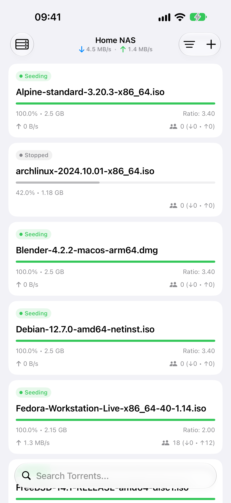
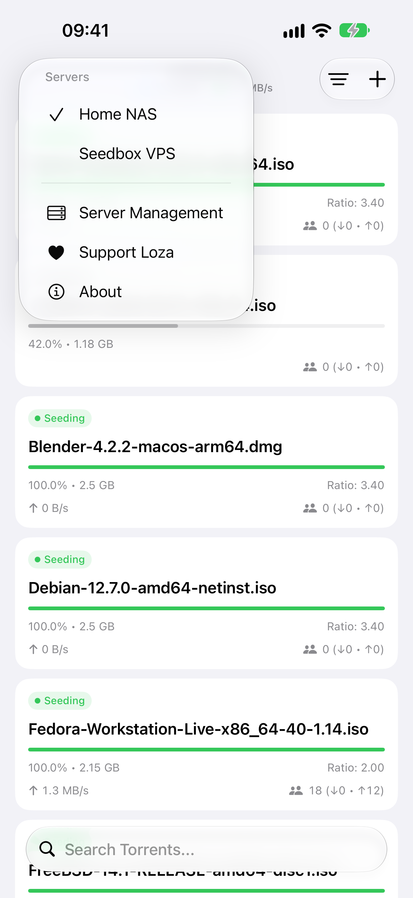
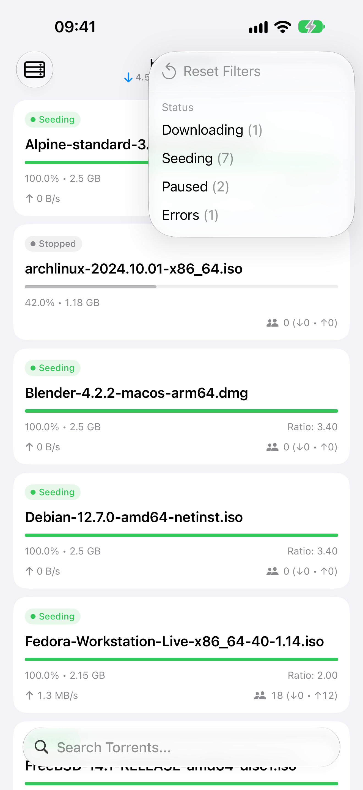
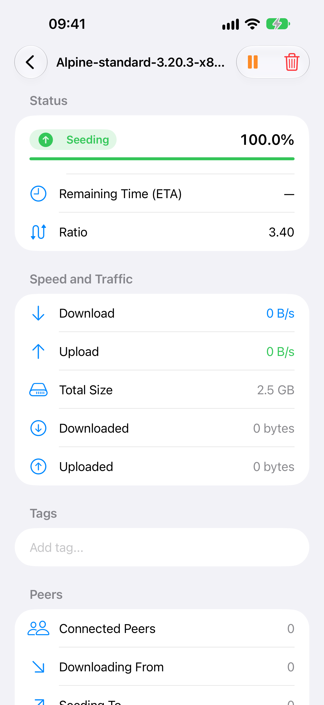

<p align="center">
  
</p>

<h1 align="center">Loza</h1>

<p align="center">
  <strong>Native, lightweight, and privacy-first iOS & iPadOS remote manager for Transmission daemons.</strong>
</p>

<p align="center">
  <a href="https://developer.apple.com/ios/"></a>
  <a href="https://developer.apple.com/ipados/"></a>
  <a href="https://swift.org"></a>
  <a href="LICENSE"></a>
  <a href="PRIVACY.md"></a>
  
</p>

---

## Overview

**Loza** is a lightweight, modern, and open-source iOS and iPadOS client designed for remote administration of [Transmission](https://transmissionbt.com) BitTorrent daemons running on home NAS devices, Synology, TrueNAS, Unraid, Raspberry Pi, or remote servers.

Built from the ground up using **Swift 6 Strict Concurrency** and **SwiftUI**, Loza delivers an authentic Apple platform experience with real-time transfer monitoring, multi-server switching, granular file priority management, and connected peer inspection — all while strictly honoring user privacy.

<p align="center">
  
  
  
  
</p>

---

## Key Features

- ⚡ **Pure Native SwiftUI & Swift 6:** Modern, responsive UI adhering to Apple Human Interface Guidelines, built with Swift 6 Strict Concurrency and the `@Observable` state macro.
- 🛡️ **Zero Telemetry & 100% Privacy:** No third-party analytics SDKs, advertising libraries, or user tracking. All communication occurs strictly and directly between your device and your Transmission server.
- 🔐 **Keychain Credential Protection:** All Transmission passwords and authentication tokens are secured exclusively in Apple's encrypted `Keychain` (`kSecClassGenericPassword`), never in plaintext `UserDefaults`.
- 🎛️ **Multi-Server Management:** Easily configure and switch between multiple Transmission daemon profiles with independent ports, RPC mount paths, authentication, and SSL trust settings.
- 📊 **Comprehensive Torrent Inspection:**
  - Real-time aggregate upload/download speed indicators docked in the system bar.
  - Multi-criteria filtering by status categories, custom tags, and tracker domains in a dedicated popover.
  - Native pull-to-search for instant torrent lookup.
  - Inspect file lists with granular download priorities (*High*, *Normal*, *Low*, *Do Not Download*).
  - Live list of connected peers with country codes, client software identification, transfer rates, and flags.
- 🏷️ **Tag & Label Organization:**
  - View and edit custom tags directly from torrent list rows and detail views.
  - Intelligent tag suggestions and autocomplete based on existing server tags when adding new torrents.
  - Fast multi-select filtering by tags to organize large media and distribution libraries effortlessly.
- ➕ **Convenient Torrent Addition:**
  - Direct paste of magnet URIs with automatic `magnet://` deep linking support.
  - Native document file picker to import `.torrent` files directly from Files, iCloud Drive, or local storage.
  - Tag assignment with server suggestions and custom download destination history with auto-start controls.
- 🌐 **Robust Transmission RPC Engine:**
  - Automatic CSRF token handshake: transparently intercepts HTTP `409 Conflict` to renegotiate `X-Transmission-Session-Id` with automatic request replay.
  - Full support for HTTPS and self-signed SSL/TLS certificates via customizable trust evaluators.
- 📳 **Contextual Haptics:** Polished tactile feedback for play/pause toggles, swipe actions, and successful operations via `UIImpactFeedbackGenerator`.
- 🌍 **Fully Localized in 6 Languages:**
  - 🇺🇸 English (`en`)
  - 🇺🇦 Ukrainian (`uk`)
  - 🇩🇪 German (`de`)
  - 🇫🇷 French (`fr`)
  - 🇪🇸 Spanish (`es`)
  - 🇵🇱 Polish (`pl`)
- ☕ **StoreKit 2 Tip Jar:** Completely optional tips and subscriptions for supporters wanting to help fund open-source development.

---

## Architecture & Tech Stack

Loza follows a clean, modular architecture separating UI, presentation state, networking, and security:

```text
Loza/
├── App/                  # App entry point, AppEnvironment (DI container & active server state)
├── Core/
│   ├── Models/           # Domain models: Torrent, ServerConfig, SessionStats, TorrentFile, Peer
│   ├── Network/          # TransmissionClient, TransmissionInterceptor (CSRF & Auth), RPC protocols
│   ├── Storage/          # KeychainService (passwords), ServerRepository (UserDefaults)
│   ├── Haptics/          # HapticFeedbackManager (impact, notification, selection)
│   └── Purchases/        # StoreKit 2 PurchaseManager & Tip Jar services
├── Features/
│   ├── TorrentList/      # TorrentListView, TorrentRowView, SpeedIndicatorView, FilterChipView
│   ├── TorrentDetail/    # TorrentDetailView (summary, files, peer swarm)
│   ├── AddTorrent/       # AddTorrentView (magnet paste & .torrent file importer)
│   ├── ServerManagement/ # ServerListView, ServerEditView, connection testing
│   └── TipJar/           # TipJarView, ConfettiView
└── Resources/
    ├── Localization/     # Localizable.xcstrings, InfoPlist.xcstrings (6 languages)
    └── Assets.xcassets   # AppIcon, Color assets
```

| Component | Technology | Description |
| :--- | :--- | :--- |
| **Language** | Swift 6.0 | Strict Concurrency checking enabled (`-strict-concurrency=complete`) |
| **UI Framework** | SwiftUI (iOS 17.0+) | Modern `@Observable` macros, `NavigationStack`, and String Catalogs |
| **Networking** | Alamofire 5.x | Custom `RequestInterceptor` for CSRF 409 handshake and `DisabledTrustEvaluator` for self-signed SSL |
| **Security** | Apple Security Framework | Secure credential storage via Keychain Services (`kSecClassGenericPassword`) |
| **Monetization** | StoreKit 2 | Modern in-app purchases for optional tip jar support |

---

## Building and Development

### Prerequisites

- **macOS Sonoma (14.0)** or **macOS Sequoia (15.0+)**
- **Xcode 16.0+**
- iOS 17.0+ Simulator or physical device

### Building with Xcode CLI

Due to sandboxing and derived data management, pass `-derivedDataPath /tmp/DerivedData`:

```bash
# Clone the repository
git clone https://github.com/rsimenok/loza.git
cd loza

# Build for iOS Simulator
xcodebuild -project Loza.xcodeproj \
           -scheme Loza \
           -destination 'platform=iOS Simulator,name=iPhone 16' \
           -derivedDataPath /tmp/DerivedData \
           build

# Run Unit Tests
xcodebuild test \
           -project Loza.xcodeproj \
           -scheme Loza \
           -destination 'platform=iOS Simulator,name=iPhone 16' \
           -derivedDataPath /tmp/DerivedData
```

---

## Roadmap

- [x] **v1.0 (Current Release):**
  - Multi-server Transmission management with secure Keychain storage.
  - Multi-criteria filtering by status, custom tags, and tracker domains in a dedicated popover.
  - Granular tag management with inline editing and server-wide autocomplete suggestions.
  - Torrent dashboard with real-time speed badges, filter chips, and search.
  - Detailed torrent metrics, file priority control, and connected peer list.
  - Adding torrents via magnet links and `.torrent` file importer.
  - Native iOS & iPadOS support with full dark mode compatibility.
  - 6 localizations (English, Ukrainian, German, French, Spanish, Polish).
  - StoreKit 2 Supporter Tip Jar.
- [ ] **v1.1 (Next Release):**
  - **Share Extension:** Add torrents directly from Safari or Files in one tap.
  - ...and more improvements coming soon.

---

## Privacy Policy

Loza is dedicated to complete transparency and user privacy. We do not collect, transmit, or share any personal information, device telemetry, or connection data.

For full details, please review our [Privacy Policy](PRIVACY.md).

---

## License

Loza is open-source software licensed under the **GNU General Public License v3.0 (GPLv3)**. See the [LICENSE](LICENSE) file for terms and conditions.

```text
Copyright (C) 2026 Roman Simenok.

This program is free software: you can redistribute it and/or modify
it under the terms of the GNU General Public License as published by
the Free Software Foundation, either version 3 of the License, or
(at your option) any later version.
```
